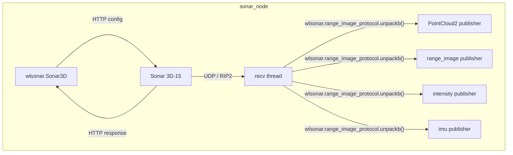

# waterlinked_sonar_3d15

ROS 2 driver for the [Water Linked Sonar 3D-15](https://www.waterlinked.com/3dsonar), built on the official [`wlsonar`](https://github.com/waterlinked/wlsonar) Python library.

## Features

- **High / low frequency mode** switching (firmware >= 1.7.0)
- **PointCloud2**, **range image**, **intensity image** and **IMU message** publishing
- Full sonar configuration via ROS parameters (speed of sound, range, salinity, UDP mode)
- Runtime parameter reconfiguration
- Diagnostic publishing (temperature, system status)
- Non-blocking UDP receiver (dedicated thread)
- Clean shutdown with acoustics disable

## Requirements

- ROS 2 (Humble / Jazzy / Rolling)
- Python >= 3.10
- Water Linked Sonar 3D-15 with firmware >= 1.5.1 (>= 1.7.0 for mode/salinity features and >= 1.8.0 for IMU output)

## Installation

### Install the `wlsonar` dependency

```bash
pip install wlsonar
```

### Build the package

```bash
cd ~/your_ws
colcon build --packages-select waterlinked_sonar_3d15
source install/setup.bash
```

## Usage

### Launch with default parameters

```bash
ros2 launch waterlinked_sonar_3d15 sonar_3d15.launch.py
```

### Launch with custom parameters

```bash
ros2 launch waterlinked_sonar_3d15 sonar_3d15.launch.py \
    params_file:=/path/to/your_params.yaml
```

### Run the node directly

```bash
ros2 run waterlinked_sonar_3d15 sonar_node --ros-args \
    -p sonar_ip:=192.168.194.96 \
    -p mode:=high-frequency \
    -p acoustics_enabled:=true
```

## Topics

| Topic | Type | Description |
|---|---|---|
| `~/point_cloud` | `sensor_msgs/PointCloud2` | XYZ point cloud from range images |
| `~/range_image` | `sensor_msgs/Image` (32FC1) | Range image as float32 distances in meters |
| `~/intensity_image` | `sensor_msgs/Image` (8UC1) | Logarithmic signal strength image |
| `~/camera_info` | `sensor_msgs/CameraInfo` | Sonar lens model (pinhole projection) |
| `~/imu` | `sensor_msgs/Imu` | Imu message |
| `/diagnostics` | `diagnostic_msgs/DiagnosticArray` | Temperature, firmware, system status |

Topic names are configurable via the `topic_*` parameters (see below). The defaults above use the `~/` prefix, which resolves relative to the node name.

Images and `CameraInfo` use `<frame_id>_optical` by default. The node publishes
a static TF so optical +Z points along the native point cloud's +X axis.
Image rows are reversed to agree with the vertical direction of the installed
`wlsonar` XYZ conversion. Point cloud coordinates are unchanged.
Use `sonar_link` (or another connected frame) as the RViz Fixed Frame.
The pinhole `CameraInfo` represents the nominal FOV, not an exact projection
of the sonar's uniformly spaced yaw/pitch samples; corners can differ.

## Parameters

| Parameter | Type | Default | Description |
|---|---|---|---|
| `sonar_ip` | string | `192.168.194.96` | IP address of the Sonar 3D-15 |
| `chipid` | string | Hardware reported | Read-only sonar chip ID; empty if unavailable |
| `firmware_version` | string | Hardware reported | Read-only firmware version; empty if unavailable |
| `frame_id` | string | `sonar_link` | TF frame ID for point clouds |
| `optical_frame_id` | string | `""` | Image/CameraInfo frame; empty uses `<frame_id>_optical` |
| `acoustics_enabled` | bool | `true` | Enable acoustic imaging |
| `speed_of_sound` | double | `0.0` | Speed of sound in m/s; `0.0` uses the sonar's internal default (auto) |
| `mode` | string | `low-frequency` | `low-frequency` or `high-frequency` (fw >= 1.7.0) |
| `salinity` | string | `salt` | `salt` or `fresh` (fw >= 1.7.0) |
| `range_min` | double | `0.3` | Minimum imaging range in meters |
| `range_max` | double | `15.0` | Maximum imaging range in meters |
| `udp_mode` | string | `multicast` | `multicast` or `unicast` |
| `interface_ip` | string | `0.0.0.0` | Local IP for multicast join / unicast bind |
| `unicast_destination_ip` | string | `""` | Unicast destination IP |
| `unicast_destination_port` | int | `0` | Unicast destination port |
| `topic_point_cloud` | string | `~/point_cloud` | Topic name for PointCloud2 output |
| `topic_range_image` | string | `~/range_image` | Topic name for range image output |
| `topic_intensity_image` | string | `~/intensity_image` | Topic name for intensity image output |
| `topic_imu` | string | `~/imu` | Topic name for IMU output |
| `imu_output_enabled` | bool | `true` | Enable IMU batch output (firmware >= 1.8.0) |
| `topic_camera_info` | string | `~/camera_info` | Topic name for CameraInfo output |
| `diagnostics_period` | double | `5.0` | Seconds between diagnostic queries |

### Speed of sound

`speed_of_sound: 0.0` selects the sonar's internal default (auto); it does not
mean a physical sound speed of zero. Set a positive value to specify an
explicit speed in m/s.

`ros2 param get /sonar_node speed_of_sound` returns the configured ROS parameter,
not the actual speed used by the sonar. In default/auto mode it therefore
returns `0.0`. The effective value for each received range image is available
in the RIP `RangeImage.speed_of_sound` field.

### Reading device identity

The node reads device identity at startup. These parameters cannot be changed
at runtime, and YAML/command-line overrides are ignored:

```bash
ros2 param get /sonar_node chipid
ros2 param get /sonar_node firmware_version
```

They contain empty strings if the startup connection fails. Restart the node
after reconnecting or updating the sonar firmware to refresh them.

### Changing parameters at runtime

On firmware older than 1.8.0, startup falls back to `imu_output_enabled: false`
and continues sonar imaging. Enabling IMU output at runtime is rejected with
the firmware version error; disabling it is accepted as a no-op. Runtime IMU
changes are also rejected if the sonar is disconnected or the installed
`wlsonar` lacks IMU output control. If an IMU configuration request fails due
to a communication error at startup, the requested parameter is retained and
a warning reports that the hardware state is unconfirmed.

The following parameters can be changed while the node is running using `ros2 param set`:

| Parameter | Example value | Notes |
|---|---|---|
| `acoustics_enabled` | `true` / `false` | Turns acoustic imaging on or off |
| `speed_of_sound` | `1500.0` | Adjust for water conditions (m/s) |
| `mode` | `low-frequency` / `high-frequency` | Requires firmware >= 1.7.0 |
| `salinity` | `salt` / `fresh` | Requires firmware >= 1.7.0 |
| `range_min` | `0.5` | Minimum imaging range (meters) |
| `range_max` | `10.0` | Maximum imaging range (meters) |
| `imu_output_enabled` | `true` / `false` | Enable IMU batch output (firmware >= 1.8.0) |

First, find the node name:

```bash
ros2 node list
```

Then set any parameter (replace `<node_name>` with the result above, e.g. `/sonar_node`):

```bash
ros2 param set <node_name> mode high-frequency
ros2 param set <node_name> range_max 10.0
ros2 param set <node_name> acoustics_enabled false
```

You can also inspect the current value of any parameter:

```bash
ros2 param get <node_name> mode
```

All other parameters (`sonar_ip`, `frame_id`, `optical_frame_id`, `udp_mode`, `interface_ip`, `unicast_destination_ip`, `unicast_destination_port`, `topic_*`, `diagnostics_period`) are read-only after startup and require a node restart to change.

## Architecture



## Diagnostics Tool

The package includes a standalone diagnostics node (`sonar_diag`) for benchmarking the sonar.

Run it with the regular sonar driver stopped when using unicast: both nodes
configure the sonar's UDP destination and cannot bind the same local IP/port.
Set `interface_ip` and `unicast_destination_ip` in `config/diag_params.yaml` to
the receiving computer's IP, and `sonar_ip` to the sonar's IP.

The report includes UDP packet counts, decode errors and receiver status.
If it reports zero packets with the receiver running, check the configured IPs,
firewall and network path. Non-image messages such as IMU batches are counted
separately and excluded from image rate and timing measurements.

### Launch with parameters file

```bash
ros2 launch waterlinked_sonar_3d15 sonar_diag.launch.py
# or with a custom params file:
ros2 launch waterlinked_sonar_3d15 sonar_diag.launch.py params_file:=/path/to/diag_params.yaml
```

## Launch with IMU orientation

`sonar_with_imu_orientation.launch.py` starts the sonar driver and
`imu_filter_madgwick` to estimate orientation from the sonar's accelerometer
and gyroscope. Source your ROS 2 environment, then install the filter for
your ROS distribution (if not already installed):

```bash
sudo apt install ros-${ROS_DISTRO}-imu-filter-madgwick
```

After building the package and sourcing your workspace, launch both nodes:

```bash
ros2 launch waterlinked_sonar_3d15 sonar_with_imu_orientation.launch.py
```

By default, the launch uses `config/default_params.yaml` for the sonar and
`config/imu_filter_params.yaml` for the filter. Keep `imu_output_enabled: true`
in the sonar configuration (requires firmware >= 1.8.0). To override either
configuration, use its separate launch argument:

```bash
ros2 launch waterlinked_sonar_3d15 sonar_with_imu_orientation.launch.py \
    params_file:=/absolute/path/to/default_params.yaml \
    imu_filter_params_file:=/absolute/path/to/imu_filter_params.yaml
```

With the default configuration and no namespace, the driver publishes raw IMU
data on `/sonar_node/imu`, and the filter publishes orientation estimates on
`/imu/data` and a TF from `world` to `sonar_imu_link`.

The launch also publishes the static mounting transform from `sonar_imu_link`
to `sonar_link`. It uses the earlier demo's translation of
`(-0.022, -0.046, -0.003)` meters and zero rotation. These values describe the
sonar origin in the IMU frame; verify them against your mounting geometry.
Override them with `mount_x`, `mount_y`, `mount_z` (meters) and `mount_roll`,
`mount_pitch`, `mount_yaw` (radians). If your robot URDF already supplies this
transform, launch with `publish_mount_tf:=false`.

Use the `sonar_frame_id` and `imu_frame_id` launch arguments to change the frame
names; these override the corresponding sonar YAML parameters. The default TF
chain for viewing the point cloud is:

```text
world -> sonar_imu_link -> sonar_link -> sonar_link_optical
```

The sonar driver publishes the final optical-frame transform. Start `rviz2`,
set **Fixed Frame** to `world`, and add a
**PointCloud2** display using `/sonar_node/point_cloud`.

The default filter uses `use_mag: false`: roll and pitch are gravity referenced,
but yaw has no absolute heading reference and can drift. This setup estimates
orientation only; it does not track the sonar's position.

### Continuous monitoring

Prints live data rates and range/intensity image timing offsets every second:

```bash
ros2 run waterlinked_sonar_3d15 sonar_diag --ros-args \
    -p sonar_ip:=192.168.2.190 \
    -p interface_ip:=192.168.2.1
```

Example output:

```
[INFO] --- Sonar Diagnostics ---
[INFO]   RangeImage:  4.2 Hz  (seq 1042, 150x16, freq 750000 Hz)
[INFO]   BitmapImage: 4.1 Hz  (seq 1042, 150x16, freq 750000 Hz)
[INFO]   RI-BI offset: 12.3 ms avg (last 10 pairs)
```

### Mode-switch latency test

Measures how long it takes to switch between low-frequency and high-frequency modes, and how long until data resumes after each switch:

```bash
ros2 run waterlinked_sonar_3d15 sonar_diag --ros-args \
    -p sonar_ip:=192.168.2.190 \
    -p interface_ip:=192.168.2.1 \
    -p test_switch:=true \
    -p cycles:=3
```

Reports API call latency, data blackout duration, and confirms the resolution changed by logging the first image dimensions after each switch.

### Diagnostics parameters

| Parameter | Type | Default | Description |
|---|---|---|---|
| `sonar_ip` | string | `192.168.194.96` | IP address of the Sonar 3D-15 |
| `udp_mode` | string | `multicast` | `multicast` or `unicast` |
| `interface_ip` | string | `0.0.0.0` | Local interface IP for socket bind |
| `unicast_destination_ip` | string | `""` | Unicast destination IP |
| `unicast_destination_port` | int | `0` | Unicast destination port |
| `test_switch` | bool | `false` | Run mode-switch test instead of monitoring |
| `cycles` | int | `3` | Number of switch cycles for the test |

## Sonar Modes

The Sonar 3D-15 (firmware >= 1.7.0) supports two imaging modes:

| | Low-frequency (1.2 MHz) | High-frequency (2.4 MHz) |
|---|---|---|
| **Field of View** | H 90° x V 40° | H 40° x V 40° |
| **Beam angle** | H 0.85° x V 1.60° | H 0.45° x V 0.85° |

## License

MIT
